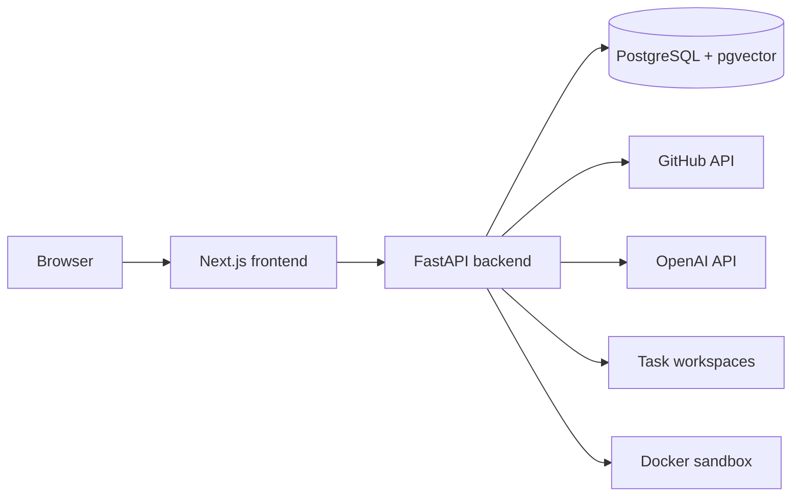
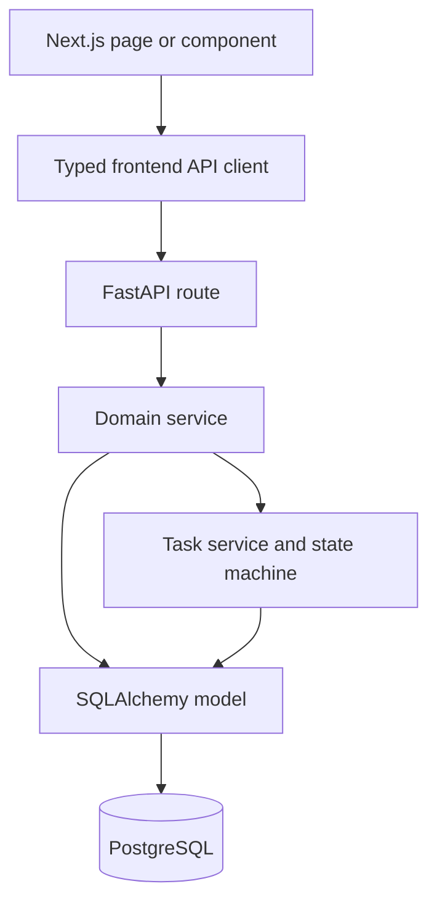

# Architecture

## The short description

RepoPilot is a **modular monolith with an orchestrated finite-state-machine
workflow**.

- **Modular monolith** means backend features are separated into modules but
  deployed together as one FastAPI application.
- **Orchestrated workflow** means one backend service calls the stages in the
  correct order.
- **Finite-state machine** means a task can move only through explicitly
  allowed statuses.

RepoPilot is not currently a collection of microservices.

## Main components



### Frontend

The Next.js frontend renders pages, calls typed API functions, caches server
data with TanStack Query, and displays backend task state. It must not invent
or independently change workflow state.

### Backend

FastAPI authenticates the user, authorizes repository access, validates
requests, starts tasks, coordinates AI services, enforces security rules, and
publishes approved changes.

### PostgreSQL and pgvector

PostgreSQL is the source of truth for users, sessions, installations,
repositories, tasks, plans, changes, runs, reviews, publications, events, and
metrics. pgvector stores code embeddings used for semantic retrieval.

### Workspaces

Each task clones its repository into:

```text
workspaces/<task-id>/repository/
```

The agent edits this local clone. It does not directly edit GitHub.

### Docker sandbox

Verification copies the workspace into a sandbox directory and runs detected
commands in restricted Node or Python containers. Resource, process, time,
output, and network limits are configured in `backend/app/core/config.py`.

## Layered request flow



The layers have different responsibilities:

| Layer | Responsibility |
| --- | --- |
| Frontend page/component | Present information and collect user actions |
| Frontend API client | Send typed HTTP requests and normalize errors |
| FastAPI route | Authenticate, authorize, validate, and translate HTTP |
| Service | Implement application behavior |
| Task service/state machine | Own task lifecycle transitions |
| SQLAlchemy model | Define persisted data |

The code is not a strict Clean Architecture implementation because services
can directly use SQLAlchemy and provider clients. It still follows clear
module and service boundaries.

## Agent domain and publication domain

This separation is a central security design:

```text
AGENT DOMAIN
  read local repository
  index and search
  plan
  edit isolated workspace
  verify and debug
  produce a change set

PUBLICATION DOMAIN
  verify authenticated human approval
  verify exact diff hash and base commit
  verify current repository permission
  create a non-default branch
  commit and push
  create a pull request
```

The AI agent does not receive tools that can push or create pull requests.
Publication is deterministic backend code.

## Backend-authoritative state

The database task row contains the current status and active artifact IDs.
`TaskStateMachine` validates every transition. `TaskEvent` rows form the
auditable timeline, but they are not the primary state. Therefore RepoPilot
uses an event log, not full event sourcing.

This rule prevents:

- Two browser tabs from independently changing task state.
- A stale UI from skipping required stages.
- An LLM from declaring a task approved or completed.
- Publication before exact-diff approval.

## Background execution

The task creation endpoint schedules the workflow with FastAPI
`BackgroundTasks`. The browser is not responsible for keeping the task alive.

Current limitation: the workflow still lives inside the backend process. A
backend restart, process crash, or deployment replacement can interrupt it.
Task events, locks, and reconciliation help detect stale tasks, but a durable
worker queue is the recommended future design for production scaling.

## Multi-user authorization

The authorization chain is:

```text
authenticated user
  → GitHub App installation owned by that user
    → repository returned for that installation
      → task owned by that user
        → task artifacts and workspace
```

Knowing a task UUID is not enough to access another user's task.

## Design patterns used

| Pattern | Where it appears |
| --- | --- |
| Modular monolith | One backend process with separated feature modules |
| Layered architecture | Routes → services → models/database |
| Orchestrator | `TaskWorkflowService` coordinates task stages |
| Finite-state machine | `services/tasks/state_machine.py` |
| Pipeline | Index → retrieve → plan → code → verify → review |
| Strategy/protocol | Provider, publisher, authenticator, and embedding interfaces |
| Human-in-the-loop | Final diff review gate |
| RAG | Hybrid repository code retrieval |
| Optimistic concurrency and locking | Task version and operation locks |
| Defense in depth | Authorization, path checks, sandbox, diff integrity, permission rechecks |

## Continue reading

- [Backend guide](backend-guide.md)
- [Frontend guide](frontend-guide.md)
- [Task workflow](task-workflow.md)
- [RAG pipeline](rag-pipeline.md)
