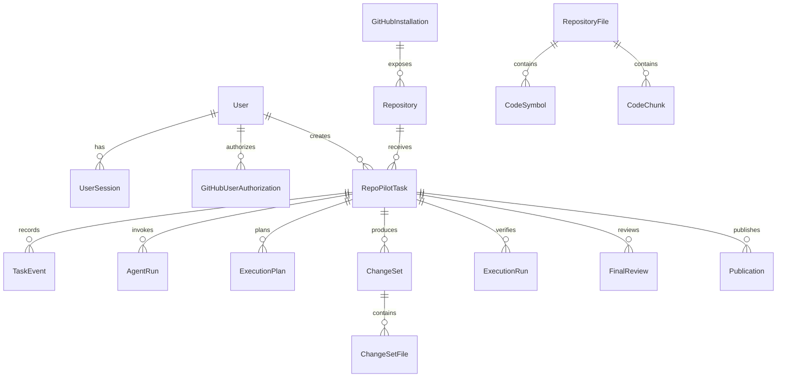

# Database Guide

RepoPilot uses PostgreSQL as its durable source of truth. The `pgvector`
extension adds vector search for the RAG pipeline.

## What "source of truth" means

The browser may cache task data, and a workspace contains temporary files, but
the database decides which user, repository, task state, plan, review, and
publication records exist.

Do not manually change a task status just to make the UI look correct. Related
records and invariants may no longer agree.

## Main model groups

| Area | Models | Purpose |
| --- | --- | --- |
| Users and sessions | `User`, `UserSession` | Signed-in identity and session lifecycle |
| GitHub authorization | `GitHubUserAuthorization`, `OAuthState`, `GitHubInstallation` | Encrypted user authorization, OAuth safety, and App installations |
| Repositories | `Repository` | Repositories discovered through installations |
| Tasks | `RepoPilotTask`, `TaskOperationLock`, `TaskEvent` | Workflow state, concurrency control, and timeline |
| RAG index | `RepositoryFile`, `CodeSymbol`, `CodeChunk` | Searchable repository content |
| Planning and coding | `ExecutionPlan`, `AgentRun`, `ChangeSet`, `ChangeSetFile` | AI output and exact proposed changes |
| Verification and debugging | `ExecutionRun`, `DebugAttempt` | Check results and corrective attempts |
| Human review and publication | `FinalReview`, `Publication` | Approval evidence and pull request result |
| Evaluation | `EvaluationRun`, `EvaluationTaskResult` | Repeatable quality measurement |

## Simplified relationships



This diagram is intentionally simplified. Read the SQLAlchemy model files and
Alembic migrations for exact columns, constraints, and indexes.

## State record and event timeline

`RepoPilotTask` stores the current state so the UI can answer "where is this
task now?" efficiently.

`TaskEvent` stores important transitions so operators and users can answer "how
did it get here?"

Updating current state and appending its event should happen in the same
transaction when the operation requires both. Otherwise a process failure could
leave them disagreeing.

## Operation locks

`TaskOperationLock` protects long-running or repeated actions such as restart
and publication. It helps prevent two browser tabs or duplicate requests from
starting conflicting operations.

Database locks do not replace workspace checks. The service still validates the
Git working tree and approved artifacts.

## Code search storage

`CodeChunk` combines:

- source text;
- path and language metadata;
- PostgreSQL full-text search data;
- a pgvector embedding.

The vector dimension in the schema must match the configured embedding model.
Changing the model dimension requires a migration and reindexing.

## Migrations

Alembic records and applies schema changes.

From `backend/` with the virtual environment active:

```bash
python -m alembic upgrade head
```

To inspect the current migration:

```bash
python -m alembic current
```

When a model change requires a migration, review the generated migration
carefully. Automatic generation cannot understand every data-safety decision.

Never edit an already deployed migration to represent a new change. Add a new
migration.

## Transactions

Use one transaction for a business operation that must succeed or fail as a
unit. Examples include:

- consuming an OAuth state and creating the session;
- saving a state transition and event;
- binding a final review to an exact change set;
- saving publication result and final task state.

Keep network calls outside long database transactions where possible. Holding a
transaction open during a slow AI or GitHub request can block other work.

## Local database startup

From the repository root:

```bash
docker compose up -d postgres
```

Then apply migrations from `backend/`.

## Resetting the local database

This permanently deletes local PostgreSQL data in the Compose volume:

```bash
docker compose down -v
docker compose up -d postgres
cd backend
python -m alembic upgrade head
```

Use this only for disposable local development. It deletes users, sessions,
repositories, tasks, reviews, publications, evaluations, and the RAG index.

Do not use `docker compose down -v` in production.

## Backup and recovery

Production needs regular PostgreSQL backups and a tested restore procedure.
Back up before risky migrations.

A basic logical backup uses `pg_dump`, but the exact command depends on the
deployment provider and credentials. Managed database providers often supply
automatic snapshots; verify retention and restore behavior rather than assuming
it is enabled.

Task workspaces are separate from the database. Backing up PostgreSQL does not
back up uncommitted workspace files.

## Data safety rules

- Encrypt GitHub user tokens before storage.
- Never store raw GitHub App private keys in the database.
- Do not log database URLs containing passwords.
- Apply ownership checks to every user-scoped query.
- Use foreign keys and unique constraints to enforce invariants.
- Prefer soft operational recovery over manual SQL edits.
- Test migrations against a copy of production-like data.

## Related guides

- [RAG Pipeline](rag-pipeline.md)
- [Task Workflow](task-workflow.md)
- [Testing and Troubleshooting](testing-and-troubleshooting.md)

