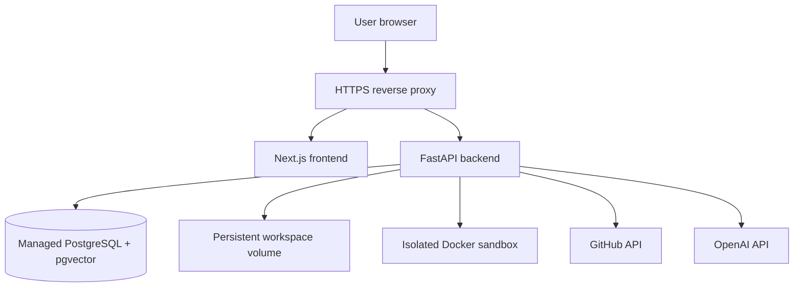

# Deployment Guide

RepoPilot can start on one small server, but it is not a purely static or
serverless application. It needs PostgreSQL, persistent task workspaces,
long-running backend work, outbound access to GitHub and OpenAI, and a secure
Docker sandbox for repository commands.

For a step-by-step $0-infrastructure demo, see
[Free-Tier Deployment](free-tier-deployment.md). The free-tier guide also
explains which popular free hosts are incompatible with the complete RepoPilot
worker.

## Recommended first production shape



A single public hostname is simplest:

```text
https://repopilot.example.com/
https://repopilot.example.com/api/v1/...
```

The reverse proxy can route page requests to Next.js and API requests to
FastAPI. This simplifies cookies, CORS, CSRF, and GitHub callbacks.

## Why many free hosts are a poor fit

Free web tiers often:

- sleep when idle;
- erase local disk;
- limit request or process duration;
- do not allow Docker;
- do not support background workers;
- provide too little memory for cloning and indexing.

They may host a frontend demo, but a complete RepoPilot backend needs the
capabilities above. Always check current provider limits before choosing one.

## Production configuration

Start from `.env.example`, but use production values:

| Setting | Production guidance |
| --- | --- |
| `APP_ENV` | `production` |
| `APP_BASE_URL` | Public HTTPS backend/base URL |
| `FRONTEND_URL` | Public HTTPS frontend URL |
| `SESSION_SECRET` | Long random secret unique to this environment |
| `COOKIE_SECURE` | `true` |
| `COOKIE_DOMAIN` | Your intended cookie domain, if needed |
| `ALLOW_LEGACY_GITHUB_REPOSITORY_ACCESS` | `false` |
| `DATABASE_URL` | TLS-protected production PostgreSQL connection |
| `OPENAI_API_KEY` | Server-side secret |
| GitHub App variables | Production GitHub App values |
| `GITHUB_USER_TOKEN_ENCRYPTION_SECRET` | Strong independent encryption secret |

Do not reuse the session secret as the token-encryption secret.

## GitHub production settings

Update the GitHub OAuth/App configuration from localhost to the public HTTPS
domain:

```text
Homepage:
https://repopilot.example.com

OAuth callback:
https://repopilot.example.com/api/v1/auth/github/callback

Setup callback:
https://repopilot.example.com/api/v1/auth/github/installations/callback
```

If webhooks are enabled, use a public HTTPS webhook endpoint and a strong,
independent webhook secret.

Choose **Any account** only when the application is ready for external users.
GitHub organization administrators may still require approval.

## Deployment order

1. Provision PostgreSQL with the `pgvector` extension.
2. Provision encrypted secret storage.
3. Provision a persistent workspace volume.
4. Build the frontend and backend artifacts.
5. Apply Alembic migrations once.
6. Start the backend.
7. Confirm `/health` and `/ready`.
8. Start the frontend and reverse proxy.
9. Complete a test sign-in, installation, task, review, and publication.
10. Enable monitoring and backups before inviting users.

Do not run schema migration independently in every autoscaled backend instance.
Use one controlled release step.

## Persistence

PostgreSQL is durable application state. The workspace volume contains active
Git repositories and execution artifacts.

At minimum:

- back up PostgreSQL regularly;
- monitor disk usage;
- define workspace retention and cleanup;
- do not place active workspaces on ephemeral storage;
- test recovery from a backend restart.

Published branches and pull requests also exist on GitHub, but GitHub is not a
replacement for the RepoPilot database.

## Background-task limitation

The current orchestrator runs through the FastAPI process. This is acceptable
for local development and a controlled single-instance deployment, but it has
limits:

- a backend restart can interrupt work;
- several backend replicas cannot safely share in-memory jobs;
- deployment draining is difficult;
- retry and lease behavior is less durable.

Before horizontal scaling, move workflows to a durable queue/worker model. A
worker should claim a task with a database-backed lease, emit heartbeats, and
resume or safely fail abandoned runs.

## Docker sandbox security

Access to the Docker daemon is effectively host-level privilege. Use a dedicated
worker host or strongly isolated runner for untrusted repository code.

Apply:

- non-root containers where possible;
- CPU, memory, process, and time limits;
- no host network unless required;
- read-only mounts except the task workspace;
- no production secrets inside verification containers;
- a restricted image allowlist;
- audit logs and cleanup of stopped containers.

Do not expose the Docker socket to the public web frontend.

## Networking and security

- Terminate TLS at a trusted reverse proxy.
- Redirect HTTP to HTTPS.
- Keep PostgreSQL private.
- Restrict backend ingress to the proxy or private network.
- Allow outbound HTTPS only where practical.
- Configure secure, HTTP-only, SameSite cookies.
- Keep CSRF checks enabled.
- Rate-limit login, task creation, restart, and publication endpoints.
- Rotate secrets and GitHub private keys using a documented procedure.

## Monitoring

Monitor:

- health and readiness;
- HTTP error rate and latency;
- active, failed, and stale tasks;
- workflow stage duration;
- GitHub and OpenAI errors;
- database connections and slow queries;
- workspace disk usage;
- Docker sandbox failures;
- token usage and cost;
- queue depth when a durable worker is added.

Use task IDs and request correlation IDs in logs. Redact all credentials.

## Scaling path

```text
Stage 1: One frontend + one backend/worker + managed PostgreSQL
Stage 2: Separate API process from durable workflow workers
Stage 3: Multiple workers with leases, isolated sandbox hosts, shared artifact storage
Stage 4: Autoscale by queue depth with per-user and per-installation limits
```

Keep PostgreSQL as the state authority throughout this path.

## Release checklist

- Tests, lint, typecheck, and production build pass.
- Database migration was reviewed and backed up.
- GitHub callback URLs match exactly.
- GitHub App permissions are minimal and approved.
- Production cookies are secure.
- Legacy repository access is disabled.
- Secrets exist only in server-side secret storage.
- Health and readiness probes pass.
- PostgreSQL backup and restore are tested.
- Workspace disk and sandbox limits are configured.
- A full pull-request publication smoke test passes.
