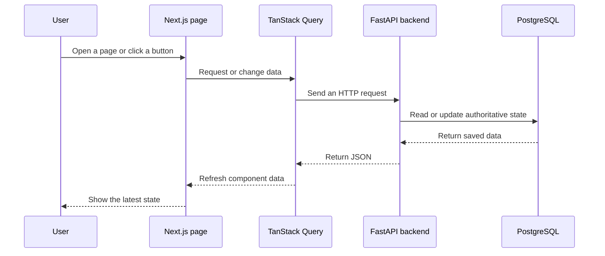

# Frontend Guide

This guide explains the RepoPilot web application in beginner-friendly terms.

## What the frontend does

The frontend is the part that users see in the browser. It lets a user:

- sign in with GitHub;
- connect repositories;
- choose an issue;
- create and monitor an AI coding task;
- approve a plan or final diff when required;
- request changes;
- publish the approved change as a pull request.

The frontend does not run the coding workflow itself. It sends requests to the
FastAPI backend and displays the backend's authoritative state.

## Main technologies

| Technology | Purpose |
| --- | --- |
| Next.js App Router | Pages, layouts, routing, and production builds |
| React | Interactive user interface |
| TypeScript | Type checking for JavaScript code |
| TanStack Query | Fetching, caching, refreshing, and mutating API data |
| CSS | Visual styling |

## Important folders

```text
frontend/
├── src/
│   ├── app/          # URL routes, pages, and layouts
│   ├── components/   # Reusable visual components
│   ├── hooks/        # Reusable React data and behavior hooks
│   ├── lib/          # API client, helpers, constants, and types
│   └── test/         # Shared test setup
├── public/           # Static assets
└── package.json      # Scripts and dependencies
```

## Main pages

| Route | What the user does there |
| --- | --- |
| `/login` | Sign in with GitHub |
| `/tasks` | See current and previous tasks |
| `/tasks/new` | Select a repository and issue, then create a task |
| `/tasks/[taskId]` | Monitor and control one task |
| `/repositories` | See repositories available to RepoPilot |
| `/github` | Inspect or manage GitHub connection state |
| `/evaluations` | View evaluation runs and results |
| `/system-status` | View backend readiness information |
| `/settings` | View application settings exposed by the UI |

## How data moves through the frontend



The browser never decides that a task is complete. It only renders the status
returned by the backend.

## API calls and authentication

The shared API client lives under `frontend/src/lib`. It sends requests to
`NEXT_PUBLIC_API_BASE_URL`.

In local development, the browser normally calls `/api/v1/...` through the
Next.js proxy. This keeps browser requests on `localhost:3000` while the backend
runs on `localhost:8000`.

Authentication uses an HTTP-only session cookie. JavaScript cannot read that
cookie, which helps protect it from browser script attacks. State-changing
requests also use CSRF protection. Do not replace this with tokens stored in
`localStorage`.

## Querying and refreshing

TanStack Query gives each backend resource a query key. A component can:

- fetch data;
- reuse cached data;
- invalidate a query after a successful change;
- refetch when the page becomes active;
- poll while a task is running.

The task detail page polls active tasks about every three seconds. Opening the
same task in a new tab creates another reader; it does not stop the backend
workflow.

The first unfiltered repository page asks the backend to refresh GitHub data.
This is why newly authorized repositories normally appear when the user returns
to the repository selector.

## Task detail tabs

| Tab | Information shown |
| --- | --- |
| Overview | Issue understanding, artifacts, status, and telemetry |
| Plan | Proposed implementation steps |
| Changes | Exact file diff and review controls |
| Verification | Test, lint, typecheck, and build results |
| Debug | Debug attempts and diagnostic information |
| Timeline | Ordered task events |
| Metrics | Timing and token information |

Actions such as approve, request changes, restart, cancel, and publish call the
backend first. The relevant queries are then invalidated so the screen reloads
the saved result.

## Loading and error states

Every data-driven page should handle four states:

1. loading;
2. success with data;
3. success with no data;
4. failure with a useful retry action.

Backend errors normally have a stable code and a human-readable message. Show
the message to the user, but keep the code available for debugging.

Do not hide an operation failure by changing only local React state. The next
refetch would restore the true backend state.

## Adding a frontend feature

Use this order:

1. Add or confirm the backend endpoint.
2. Add its request and response types under `frontend/src/lib`.
3. Add the API client function.
4. Add a query or mutation hook.
5. Build the page or reusable component.
6. Handle loading, empty, success, and error states.
7. Invalidate affected queries after a mutation.
8. Add tests.
9. Run the frontend checks listed in
   [Testing and Troubleshooting](testing-and-troubleshooting.md).

## Frontend rules that prevent common bugs

- Treat backend task state as authoritative.
- Never put GitHub private keys, client secrets, or OpenAI keys in frontend
  environment variables.
- Only variables beginning with `NEXT_PUBLIC_` are safe to expose to browser
  code.
- Keep API behavior in shared client or hook code instead of duplicating
  `fetch` logic in many components.
- Disable an action while its request is pending to avoid duplicate operations.
- Use stable query keys and invalidate all data affected by a mutation.
- Keep accessibility labels on icon-only buttons.

## Related guides

- [Architecture](architecture.md)
- [API Guide](api-guide.md)
- [Task Workflow](task-workflow.md)
- [Backend Guide](backend-guide.md)

