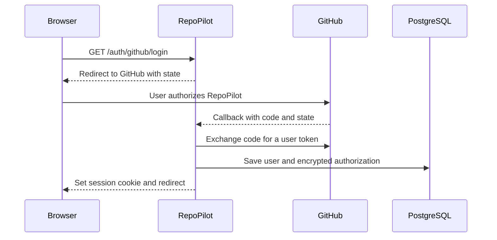
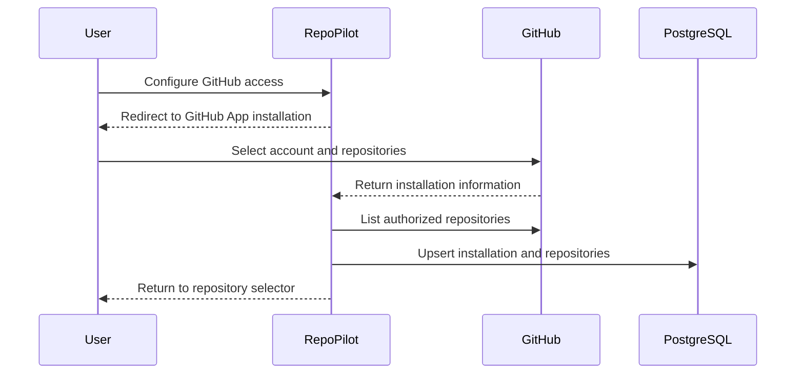

# GitHub Integration

RepoPilot uses both GitHub OAuth and a GitHub App. They solve different
problems, so a production installation needs both.

## OAuth and GitHub App are not the same

| Mechanism | Answers this question | Used for |
| --- | --- | --- |
| GitHub OAuth | "Who is this user?" | Sign-in and user-authorized GitHub actions |
| GitHub App installation | "Which repositories may RepoPilot access?" | Reading code, creating branches, and managing pull requests |

OAuth alone does not safely grant a shared application access to every user's
private repositories. A GitHub App installation lets each user or organization
choose the repositories that RepoPilot can access.

## Why the application credentials are needed

When a user clicks **Continue with GitHub**, GitHub needs to know which
application is requesting access. The client ID identifies RepoPilot and the
client secret proves that the backend is really RepoPilot.

When RepoPilot acts as a GitHub App, it signs a short-lived JSON Web Token with
the private key. GitHub verifies that signature and returns a short-lived
installation token for the selected repositories.

| Environment variable | Purpose | Secret? |
| --- | --- | --- |
| `GITHUB_APP_ID` | Numeric ID of the GitHub App | No |
| `GITHUB_APP_CLIENT_ID` | Client ID used by GitHub authorization | No |
| `GITHUB_APP_CLIENT_SECRET` | Proves the backend owns the app | Yes |
| `GITHUB_APP_PRIVATE_KEY` | Signs GitHub App JWTs | Yes |
| `GITHUB_APP_PRIVATE_KEY_PATH` | Alternative path to the private-key file | The file is secret |
| `GITHUB_APP_SLUG` | URL-friendly GitHub App name | No |
| `GITHUB_USER_TOKEN_ENCRYPTION_SECRET` | Encrypts saved user tokens | Yes |

Store secrets only in the backend environment. Never commit them or expose them
through `NEXT_PUBLIC_` variables.

## Local callback URLs

GitHub can redirect a browser to localhost during local development.

Use:

```text
Homepage URL:
http://localhost:3000

OAuth callback URL:
http://localhost:8000/api/v1/auth/github/callback

GitHub App setup URL:
http://localhost:8000/api/v1/auth/github/installations/callback
```

A webhook needs a public HTTPS URL because GitHub's servers cannot reach your
computer's `localhost`. Webhooks are not required for the basic local sign-in,
installation, repository refresh, and task flow.

## Sign-in flow



The `state` value protects the OAuth callback from forged requests. It is
single-use and expires.

## Repository installation flow



## Required GitHub App permissions

Use the smallest permissions that support the workflow:

| Repository permission | Access |
| --- | --- |
| Metadata | Read-only; GitHub makes this mandatory |
| Contents | Read and write |
| Issues | Read-only |
| Pull requests | Read and write |

After changing app permissions, an existing installation may need to accept the
new permissions on GitHub. Updating the app definition alone does not always
update an already installed copy.

## How new repositories appear

If the installation has **All repositories** access, repositories created later
are included automatically. RepoPilot refreshes the first unfiltered repository
page, so the new repository should appear when the user revisits that route.

If the installation has **Only select repositories** access, GitHub does not
grant a new repository automatically. The user must choose **Manage GitHub
Access**, add that repository to the existing installation, and return to
RepoPilot. They do not need to sign out or create another GitHub App.

## Which identity appears on a pull request

Several identities can be involved:

| Operation | Identity |
| --- | --- |
| Push the RepoPilot branch | GitHub App installation |
| Create the pull request | Signed-in GitHub user |
| Git commit metadata | Currently `RepoPilot <repopilot@example.com>` |
| App-generated activity GitHub attributes to the app | The GitHub App bot name |

GitHub controls the displayed author of an action. RepoPilot cannot make an
installation-token action look as if another user performed it. To show the
signed-in user as the pull request creator, RepoPilot uses that user's OAuth
token for pull request creation.

## Token safety

- OAuth access tokens are encrypted before database storage.
- GitHub App private keys stay on the server.
- Installation tokens are short-lived and should be requested when needed.
- Logs must not include tokens, authorization headers, private keys, or session
  cookies.
- Production cookies must be secure and sent only over HTTPS.

## Common errors

| Error code | Meaning | What to check |
| --- | --- | --- |
| `GITHUB_AUTH_NOT_CONFIGURED` | OAuth client settings are missing | Client ID, client secret, environment loading, backend restart |
| `GITHUB_APP_NOT_CONFIGURED` | GitHub App settings are incomplete | App ID, slug, private key, client values |
| `GITHUB_PERMISSION_DENIED` | Installation cannot perform the requested write | Contents and pull request permissions; installation approval |
| OAuth callback 500 | Callback exchange or persistence failed | Backend traceback, exact callback URL, secret values, database migration |
| Repository missing | App is not installed for that repository or data is stale | GitHub installation selection, then refresh/sync |

See [Testing and Troubleshooting](testing-and-troubleshooting.md) for a more
detailed diagnostic checklist and
[GitHub App Setup](github-app-setup.md) for the configuration screen.

