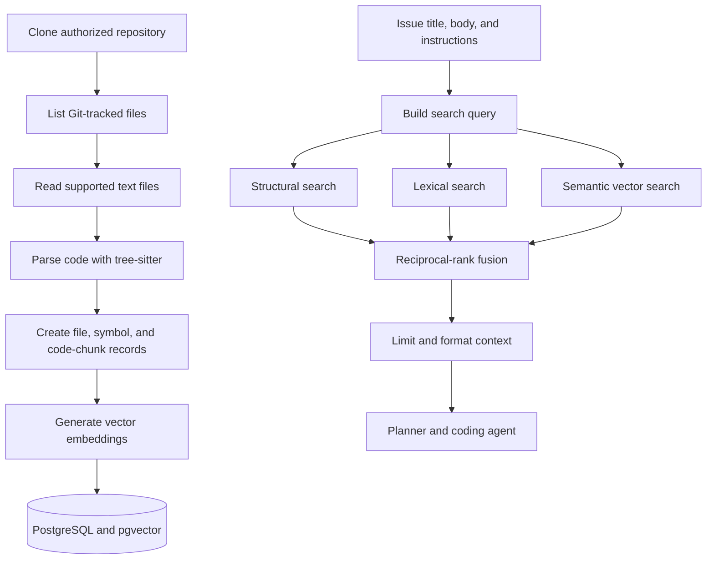

# RAG Pipeline

RAG means **retrieval-augmented generation**. Instead of sending an entire
repository to an AI model, RepoPilot finds the small parts of the codebase that
are most relevant to the issue and includes those parts in the prompt.

## Why RepoPilot needs RAG

A repository may contain thousands of files and millions of tokens. Sending all
of it would be slow, expensive, and often less accurate.

RAG gives the planner and coding agent focused evidence:

- matching file paths;
- matching symbols such as functions and classes;
- lexically similar code;
- semantically similar code;
- surrounding code needed to understand each match.

## End-to-end flow



## Step 1: Clone

RepoPilot requests a short-lived GitHub App installation token and clones the
authorized repository's default branch into:

```text
workspaces/<task-id>/repository
```

Each task has its own workspace. This avoids two tasks editing the same working
tree.

## Step 2: Scan tracked files

The scanner uses `git ls-files`. This has important benefits:

- ignored build output is excluded;
- `.git` internals are excluded;
- only files actually tracked by the repository are indexed;
- the scan follows the exact checked-out commit.

Binary files and unsupported or oversized content are skipped.

## Step 3: Parse structure

Tree-sitter parsers identify code structures for supported languages. RepoPilot
stores records such as:

- repository file;
- class;
- function or method;
- code chunk;
- source locations and language metadata.

When a language cannot be parsed structurally, file-level fallback chunks still
make text searchable.

## Step 4: Create embeddings

RepoPilot sends chunk text to the configured OpenAI embedding model. The current
default is:

```text
text-embedding-3-small
```

Embeddings are numerical representations of meaning. Code and queries with
similar meaning tend to have nearby vectors even when they use different words.
The current database vector dimension is 1536 and must stay consistent with the
embedding model and schema.

## Step 5: Store the index

PostgreSQL stores file, symbol, and chunk metadata. The `pgvector` extension
stores embeddings, and PostgreSQL full-text search supports lexical matching.

The important model groups are:

| Stored record | Why it exists |
| --- | --- |
| `RepositoryFile` | One indexed tracked file |
| `CodeSymbol` | A parsed class, function, method, or similar symbol |
| `CodeChunk` | Searchable code text, metadata, text-search data, and embedding |

See [Database Guide](database-guide.md) for the broader data model.

## Step 6: Search in three ways

RepoPilot performs complementary searches:

| Search | Best at finding |
| --- | --- |
| Structural | Named symbols and code organization |
| Lexical | Exact words, identifiers, error text, and file names |
| Semantic | Conceptually related code with different wording |

No single method is always best. For example, an error message benefits from
lexical search, while "where authorization is checked" may benefit from semantic
search.

## Step 7: Merge rankings

RepoPilot combines the individual rankings with reciprocal-rank fusion. In
simple terms:

1. a high result in any search receives a strong score;
2. results found by several searches receive contributions from each;
3. the merged list is sorted by combined score.

This avoids treating incompatible raw scores from three search systems as if
they were directly comparable.

## Step 8: Build model context

The final context is intentionally bounded:

- at most three selected chunks per file;
- approximately 6,000 tokens of repository context;
- file paths and source information are included;
- duplicates are removed or reduced.

The issue title, body, and user instructions are combined with this repository
evidence.

## Where the context is used

The planner uses retrieved code to create a realistic plan and allowed file
scope. The coding agent receives repository context plus the approved plan and
edits the task workspace.

RAG suggests relevant code; it does not authorize changes. Plan scope,
workspace validation, verification, and final review remain separate safety
boundaries.

## What happens if semantic search fails

An embedding provider can be temporarily unavailable. RepoPilot degrades to
structural and lexical evidence where possible rather than making all retrieval
unusable.

The failure should still be logged so operators know that retrieval quality may
be lower.

## Does issue selection reveal every repository file?

No. Issue selection fetches issue data only. Repository files become known
after task creation, clone, and indexing. The index then records the tracked
files at the exact task base commit.

## Current limitations

- Indexing is currently connected to a task workspace, so work can be repeated
  across tasks for the same commit.
- Unsupported languages rely more heavily on file-level chunks.
- Generated or ignored files are intentionally absent.
- Retrieval quality depends on issue detail and meaningful identifiers.
- A changed default branch requires a new clone and index to represent the new
  commit.

A future optimization could reuse a repository-commit index across tasks while
keeping each editable workspace isolated.

## Debugging retrieval

When a plan chooses the wrong area:

1. Confirm the repository cloned the expected commit.
2. Inspect indexed file and symbol counts.
3. Check whether the language is supported by the parser.
4. Check embedding-provider errors.
5. Inspect the retrieval query built from the issue.
6. Compare structural, lexical, and semantic result lists.
7. Check fusion ranking and per-file limits.
8. Confirm the selected context reached the planner.

Do not fix retrieval problems by removing plan or review checks. Retrieval
quality and execution safety are separate concerns.

