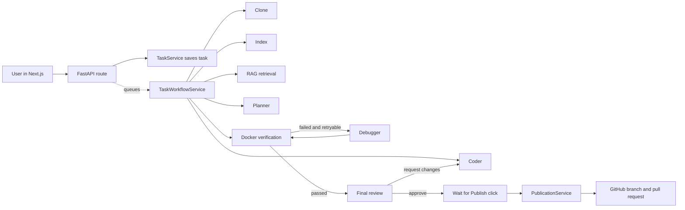
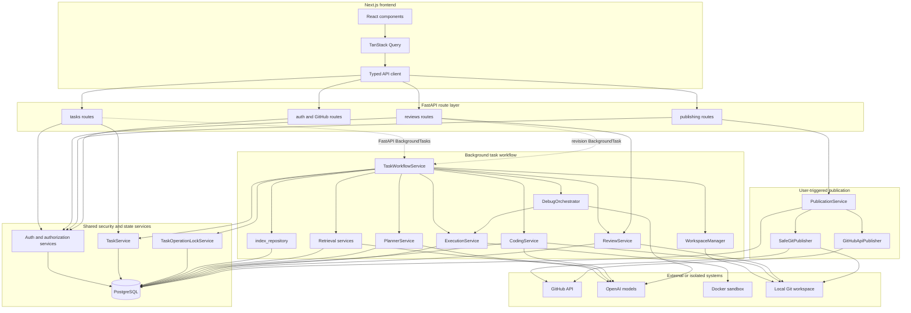
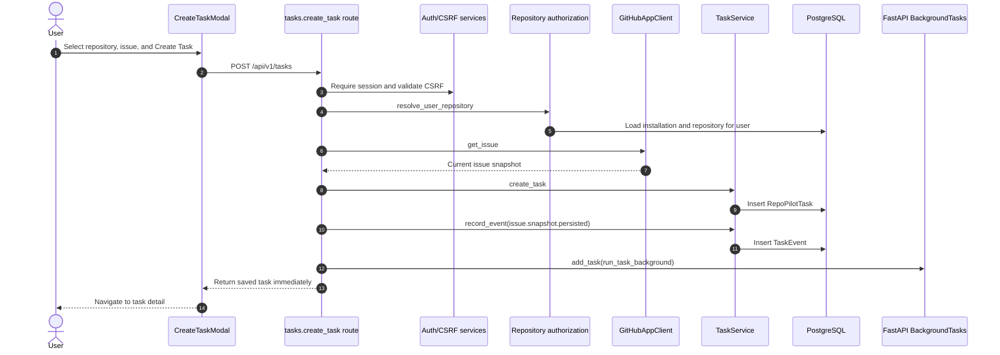
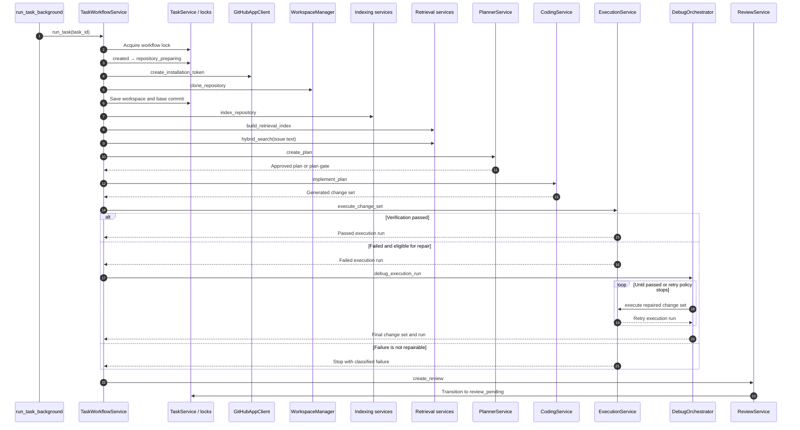
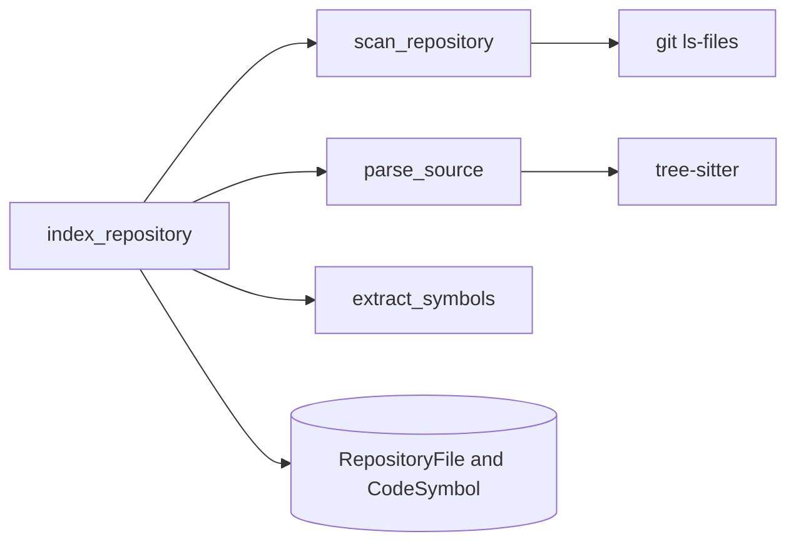
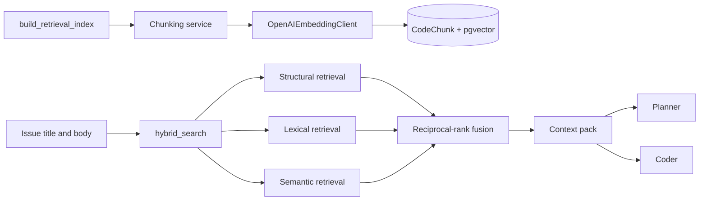
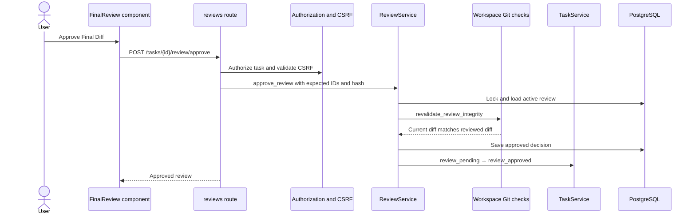
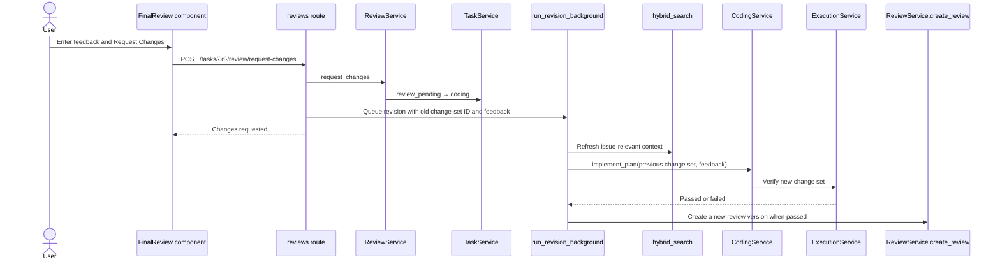
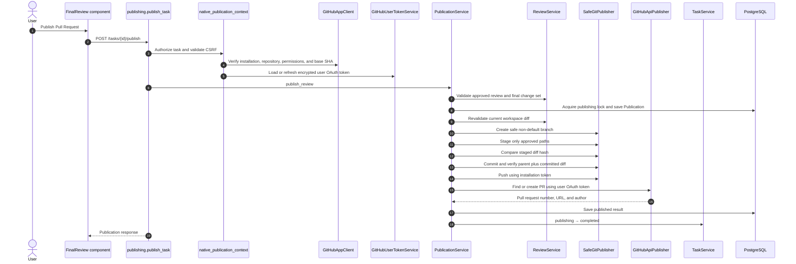

# Service-Call Workflow

This guide shows which RepoPilot service calls which other service, and when.
Read [Task Workflow](task-workflow.md) first if the task stages are unfamiliar.

## The shortest possible explanation

The browser starts operations and displays saved state. It does not run the AI
workflow.

## Main service map

Solid arrows represent direct calls. Dotted arrows show work queued to run after
the API operation has created or updated durable state.

## 1. Create Task: browser request

The browser request does only the setup work required to safely start a task.
It does not wait for planning or coding.

Important code:

| Step | Code |
| --- | --- |
| Frontend call | `frontend/src/lib/api/tasks.ts` → `createTask()` |
| HTTP route | `backend/app/api/routes/tasks.py` → `create_task()` |
| Repository ownership | `resolve_user_repository()` |
| Issue fetch | `GitHubAppClient.get_issue()` |
| Durable task record | `TaskService.create_task()` |
| Background entry point | `run_task_background()` |

## 2. Background workflow: repository to review

`run_task_background()` creates `TaskWorkflowService` and calls `run_task()`.
The workflow lock prevents duplicate starts for the same task.

### Exact service order

| Order | Service or function | What it does | Main dependency |
| --- | --- | --- | --- |
| 1 | `TaskOperationLockService.acquire()` | Stops duplicate workflow starts | PostgreSQL |
| 2 | `TaskService.transition_task()` | Saves `repository_preparing` and timeline event | PostgreSQL |
| 3 | `GitHubAppClient.create_installation_token()` | Gets short-lived repository credentials | GitHub |
| 4 | `WorkspaceManager.clone_repository()` | Shallow-clones the default branch | Git and GitHub |
| 5 | `TaskService.attach_workspace()` | Connects the task to its workspace | PostgreSQL |
| 6 | `index_repository()` | Scans tracked files and extracts symbols | Workspace and PostgreSQL |
| 7 | `build_retrieval_index()` | Creates code chunks and embeddings | OpenAI and PostgreSQL/pgvector |
| 8 | `hybrid_search()` | Runs structural, lexical, and semantic search, then fuses results | PostgreSQL and OpenAI |
| 9 | `PlannerService.create_plan()` | Builds, runs, validates, and stores a structured plan | Planner model and PostgreSQL |
| 10 | `CodingService.implement_plan()` | Runs the coder inside an approved file boundary and stores the exact diff | Coder model, workspace, PostgreSQL |
| 11 | `ExecutionService.execute_change_set()` | Detects project commands and runs them in Docker | Docker and PostgreSQL |
| 12 | `classify_execution_run()` | Decides whether a failed run is debuggable | Saved execution result |
| 13 | `DebugOrchestrator.debug_execution_run()` | Runs bounded repair attempts and retests child change sets | Debugger model, Docker, PostgreSQL |
| 14 | `ReviewService.create_review()` | Rechecks the final workspace and binds the review to an exact diff hash | Git workspace and PostgreSQL |

## Inside the major stages

### Indexing

### RAG retrieval

### Planning

`PlannerService.create_plan()`:

1. moves the task to `planning`;
2. creates a planner `AgentRun`;
3. calls `build_planner_input()`;
4. calls `AgentsPlannerRunner.run()` to use the configured model;
5. validates the structured `PlannerOutput`;
6. stores `ExecutionPlan`;
7. moves to `plan_pending_approval`;
8. auto-approves in Standard mode, or waits in Strict mode.

### Coding

`CodingService.implement_plan()`:

1. requires an approved plan;
2. validates a clean or expected revision workspace;
3. derives allowed and creatable files from the plan;
4. acquires the coding lock;
5. creates a coder `AgentRun`;
6. calls `AgentsCoderRunner.run()` with `RepoPilotPatchEditor`;
7. validates changed paths and diff limits;
8. rolls back unsafe output;
9. stores `ChangeSet` and `ChangeSetFile` records;
10. moves the task to `patch_generated`.

The model never receives unrestricted filesystem write access. The patch editor
and post-run validators enforce the approved file scope.

### Verification and debugging

`ExecutionService.execute_change_set()` validates workspace consistency, creates
an `ExecutionRun`, prepares `DockerSandbox`, detects the project, builds a
command plan, runs bounded commands, saves results, and cleans up the container.

If a failure is eligible, `DebugOrchestrator` calls the debugger model, validates
the repaired patch against the approved plan, creates a child change set, and
calls `ExecutionService` again. It stops on success, a non-retryable failure, no
progress, plan revision, or the configured attempt limit.

## 3. Human review actions

### Approve

Approval does not publish. It only records that one exact diff may be published.

### Request changes

The revision must materially change the diff. If feedback requires a file
outside the approved plan, coding stops with plan revision required.

## 4. Publish Pull Request

Publication is a separate request because it changes GitHub externally.

Two credentials are intentionally used:

- the GitHub App installation token pushes the authorized repository branch;
- the signed-in user's OAuth token creates the pull request so GitHub shows the
  user as the PR creator.

`PublicationService` rechecks the diff at the working-tree, staged, committed,
and remote-branch boundaries. Any mismatch stops publication.

## 5. Cancel, Restart, and Reconcile

| User action | Route | Calls | Result |
| --- | --- | --- | --- |
| Cancel | `POST /tasks/{id}/cancel` | authorization → CSRF → `TaskService.request_cancel()` | Saves the cancellation request; workflow cancellation checkpoints stop safely |
| Restart | `POST /tasks/{id}/restart` | authorization → repository resolution → `GitHubAppClient.get_issue()` → `TaskService.create_task()` → `run_task_background()` | Creates a new task linked by timeline events; it does not reuse a corrupted run |
| Reconcile | `POST /tasks/{id}/reconcile` | authorization → CSRF → `TaskReconciler.reconcile_task()` | Aligns saved status with durable artifacts when safe |
| Refresh page | `GET /tasks/{id}` and related queries | typed frontend clients → read routes → services/DB | Reads state only; it does not start or stop workflow work |

## Where each output is saved

| Output | Database record or location |
| --- | --- |
| Signed-in identity | `User`, `UserSession` |
| Repository access | `GitHubInstallation`, `Repository` |
| Current task status | `RepoPilotTask` |
| Timeline | `TaskEvent` |
| Clone and edits | `workspaces/<task-id>/repository` |
| Indexed files and symbols | `RepositoryFile`, `CodeSymbol` |
| RAG chunks and embeddings | `CodeChunk` |
| AI call telemetry | `AgentRun` |
| Plan | `ExecutionPlan` |
| Proposed diff | `ChangeSet`, `ChangeSetFile` |
| Verification | `ExecutionRun` |
| Repair history | `DebugAttempt` |
| Human approval | `FinalReview` |
| Branch and PR result | `Publication` |

## How the UI stays updated

The task detail page uses TanStack Query to call:

- `getTask()`;
- `getTaskTimeline()`;
- `getTaskMetrics()`;
- the plan, diff, review, execution, and publication readers when IDs exist.

While the task is active, the main task query polls about every three seconds.
Each browser tab is only another reader. Backend services continue independently
unless the backend process itself stops.

## Source files to follow while debugging

| Concern | Primary file |
| --- | --- |
| Create, cancel, restart, reconcile routes | `backend/app/api/routes/tasks.py` |
| Main background orchestration | `backend/app/services/tasks/workflow.py` |
| Task state and events | `backend/app/services/tasks/service.py` |
| Allowed state transitions | `backend/app/services/tasks/state_machine.py` |
| Repository clone | `backend/app/services/workspace/manager.py` |
| File and symbol index | `backend/app/services/indexing/indexer.py` |
| RAG build and search | `backend/app/services/retrieval/service.py` |
| Planning | `backend/app/services/planning/service.py` |
| Coding | `backend/app/agents/coder/service.py` |
| Verification | `backend/app/services/sandbox/manager.py` |
| Debug repair loop | `backend/app/services/debugging/orchestrator.py` |
| Final review and feedback | `backend/app/services/reviews/service.py` |
| Publication route and credentials | `backend/app/api/routes/publishing.py` |
| Publication integrity and GitHub calls | `backend/app/services/publishing/service.py` |
| Frontend task requests | `frontend/src/lib/api/tasks.ts` |
| Frontend review requests | `frontend/src/lib/api/reviews.ts` |
| Frontend publication requests | `frontend/src/lib/api/publications.ts` |

