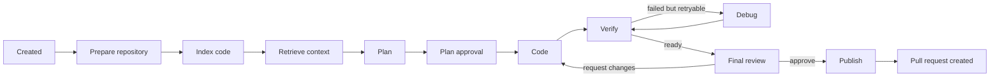

# Task Workflow

A RepoPilot task turns one GitHub issue into a reviewed pull request. The
backend owns the workflow state and records important transitions in the task
timeline.

## What happens before a task is created

The new-task screen:

1. refreshes repositories authorized through the GitHub App;
2. lists issues for the selected repository;
3. optionally creates a GitHub issue as the signed-in user, with a required
   description and optional related-file paths;
4. loads the selected or newly created issue's title and body;
5. lets the user add instructions and choose an autonomy mode.

Selecting an issue does not download and inspect the whole repository. That
starts only after the task is created.

The optional file picker reads path names from the default branch. It does not
index file contents or restrict the later RAG pipeline. Selected paths are
written into the GitHub issue body as human-provided context.

## Standard workflow

In Standard mode, a valid plan is approved automatically. The final diff still
requires explicit human approval before publication.

Strict mode keeps the plan approval as a human gate as well.

If the planner does not have enough evidence to propose a safe change, it sets
`needs_more_context` and lists concrete questions. This is not an approvable
plan. The Plan tab asks the user to answer those questions and then starts a new
planning attempt with the clarification appended to the original instructions.
The blocked attempt is retained as history and its plan is marked superseded.

## Stages

| Stage | What RepoPilot does | Main output |
| --- | --- | --- |
| Repository | Clone the authorized default branch into a task workspace | Local Git working tree |
| Index | Parse tracked source files and store searchable code records | Files, symbols, and chunks |
| Retrieval | Find code relevant to the issue | Ranked context |
| Planning | Ask the planner for a bounded implementation plan | Execution plan |
| Plan Approval | Validate or wait for approval depending on mode | Approved plan |
| Coding | Ask the coding agent to edit only allowed files | Change set and diff |
| Verification | Run selected checks in the sandbox | Execution run |
| Debugger | Diagnose a retryable failed check and revise changes | Debug attempt |
| Final Review | Show the exact diff and verification summary | Approved or rejected review |
| Publishing | Revalidate the approved state, push a branch, and open a PR | Publication record |

## State is not tied to a browser tab

Opening the same task in a second tab does not cancel planning or coding. Both
tabs read the same backend record and may poll it.

The workflow currently runs through FastAPI background work in the backend
process. Therefore:

- closing or refreshing a browser tab does not stop the task;
- opening port 3000 in another tab does not stop the task;
- restarting or crashing the backend process can interrupt in-flight work;
- a production deployment should eventually move long jobs to a durable queue.

## Plans and allowed files

The plan is more than descriptive text. It defines the intended file scope and
operations. The coding step is checked against that scope.

If the coder needs to change a file that the approved plan did not allow,
RepoPilot returns `PlanRevisionRequired`. This protects the human approval
boundary. The plan must be revised before coding continues.

## Request Changes

**Request Changes** is different from **Reject**:

- Request Changes saves the user's feedback, invalidates the previous final
  approval, returns the task to coding, and starts another implementation pass.
- Reject ends the current review path unless the task is restarted.
- Approve binds approval to the exact diff hash shown to the reviewer.

If feedback is accepted but the diff does not change, inspect the timeline and
backend logs. Possible causes include an interrupted background run, feedback
that produced no permitted edit, or a new workspace consistency failure.

## Final review integrity

The approval record includes:

- repository base commit;
- change-set identity;
- execution-run identity;
- exact diff hash;
- review version.

Before publishing, RepoPilot calculates the working-tree diff again. If it does
not match the approved diff, publication stops with a stale-state conflict. A
new review is required; silently publishing different code would violate the
approval guarantee.

## Restart, cancel, and reconcile

| Action | Purpose |
| --- | --- |
| Restart | Start a safe new attempt from the task's recoverable state |
| Cancel | Ask the workflow to stop and mark the task cancelled |
| Reconcile | Compare saved task state with durable artifacts and repair a stale display state |

Restart is protected by operation locks so repeated clicks should not create
multiple concurrent workflow runs.

Restart does not mean "ignore safety checks." Existing plan, workspace, review,
and permission invariants still apply.

For a task stopped on missing planner context, a plain restart is intentionally
blocked with `PLAN_CONTEXT_REQUIRED`. Use the clarification form on the Plan
tab. It sends the answer with the restart request, fetches the latest GitHub
issue state, and creates a clean planning attempt.

## Failures and retryability

The task stores a failure category, error type, message, and retryability flag.
Examples:

| Failure | Meaning |
| --- | --- |
| `plan_revision_required` | The approved plan does not permit the needed edit |
| `WorkspaceStateMismatchError` | The working tree differs from the state expected by the workflow |
| `sandbox_error` | A verification command could not run safely |
| `GITHUB_PERMISSION_DENIED` | GitHub no longer allows the required repository write |
| stale state conflict | The current diff is not the diff a human approved |

Use the **Timeline** tab and structured backend logs together. The UI gives the
user-safe summary; logs contain the technical cause and correlation identifiers.

## Publication guarantees

RepoPilot:

- publishes only an explicitly approved exact diff;
- verifies the repository base and permissions again;
- creates a new non-default branch;
- does not force-push;
- opens a pull request;
- never merges the pull request automatically.

## Related guides

- [Service-Call Workflow](service-call-workflow.md)
- [RAG Pipeline](rag-pipeline.md)
- [GitHub Integration](github-integration.md)
- [Database Guide](database-guide.md)
- [Testing and Troubleshooting](testing-and-troubleshooting.md)
